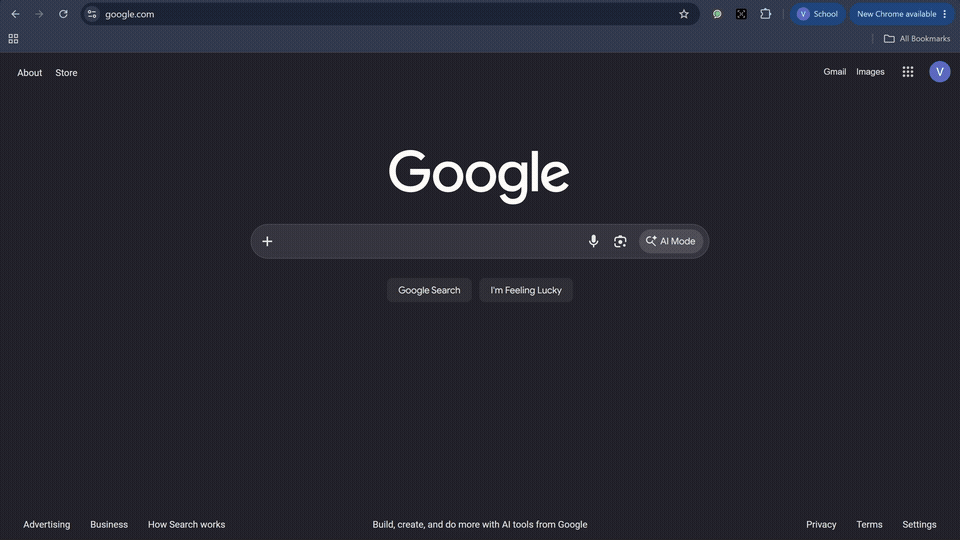
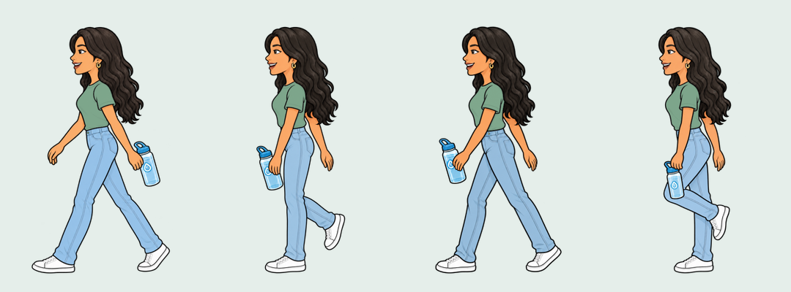
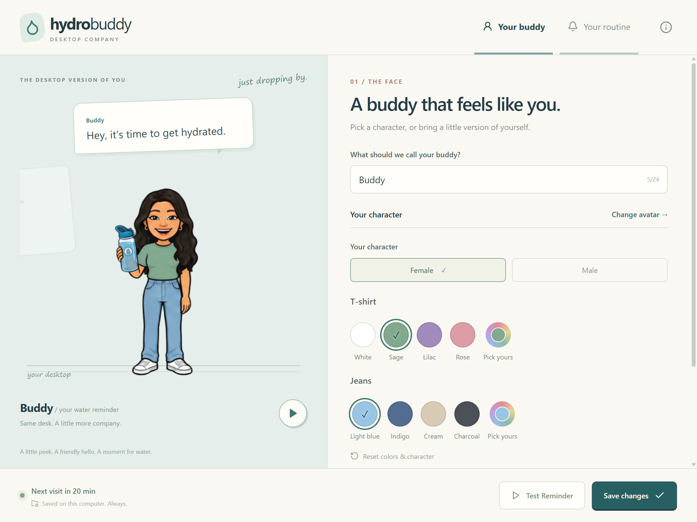
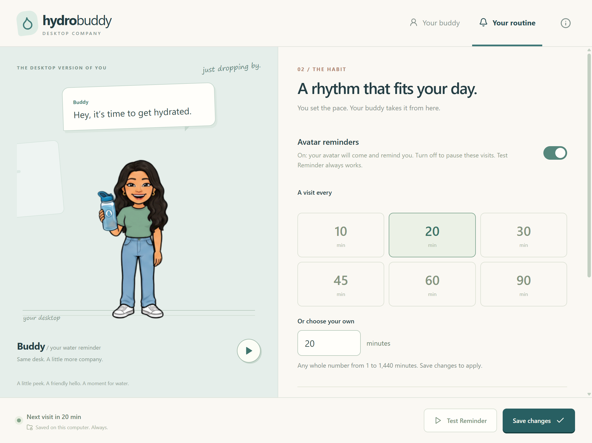

# HydroBuddy 💧

A little company at your desk. A gentle reminder to drink water.

HydroBuddy started with a simple idea: what if a water reminder felt like a familiar face stopping by? Your buddy peeks around the edge of the screen, walks over, asks whether you had some water, and heads off again. You can carry on working in the app you already have open.

It's a desktop app built with Electron, React and TypeScript. Once installed, it runs locally. No account, subscription, browser extension or internet connection is needed.

**Current version: 1.9.2 beta.** Windows has been tested locally. macOS builds are configured, but still need testing on real Macs.

[Download a release](https://github.com/Vriddhi23/HydroBuddy/releases) · [Report a problem](https://github.com/Vriddhi23/HydroBuddy/issues) · [Release and Mac testing guide](docs/LAUNCH-GUIDE.md)

## See it in action



[Watch or download the MP4 demo](docs/media/hydrobuddy-linkedin-demo.mp4).

The demo shows the real Windows app over Google in Chrome. The same walking cycle is used in the preview and desktop reminders.



## Make yourself a buddy

Choose a female or male character, pick a T-shirt color and jeans color, then preview the animation and save. Use a preset swatch or choose your own color. The colors follow your buddy through the walk and reactions.

You can also change your buddy's name and the reminder message. Face upload and AI face replacement aren't part of this release.



## Find a rhythm that works for you

Reminders start at **60 minutes**. Choose 10, 20, 30, 45, 60 or 90 minutes, or enter any whole number from 1 to 1,440 minutes. Click **Save changes** to apply your choice.



The two switches do different jobs:

| Setting | What it does |
| --- | --- |
| **Avatar reminders** | On: your buddy visits at the selected interval. Off: scheduled visits are paused. |
| **Start when I log in** | Opens HydroBuddy when you sign in. It doesn't turn paused reminders back on. |

Keep both on if you want automatic reminders after signing in. Startup is off until you enable it. **Test Reminder** works even when scheduled reminders are paused.

During a visit, choose **Yes** for a small celebration, **Not yet** for a gentle response, or use the cross to dismiss. If you leave the question unanswered, your buddy leaves after a short wait. A new full interval starts once the visit finishes.

Closing Settings keeps HydroBuddy running in the system tray on Windows or the menu bar on Mac. Use the droplet menu to reopen Settings, test a reminder, pause visits or quit completely.

## Install

Open the [Releases page](https://github.com/Vriddhi23/HydroBuddy/releases) and expand **Assets** on the release you want. Download the installer for your computer; the automatic “Source code” archives are for developers.

| Computer | Installer |
| --- | --- |
| Windows x64 | `HydroBuddy-Setup.exe` |
| Apple silicon Mac, macOS 13+ | `HydroBuddy-1.9.2-mac-arm64.dmg` |
| Intel Mac, macOS 13+ | `HydroBuddy-1.9.2-mac-x64.dmg` |

Run the EXE on Windows. On Mac, open the DMG, drag HydroBuddy into Applications, eject the DMG and launch from Applications. Mac files are available only after the corresponding build succeeds and the maintainer attaches them to the release.

This is an early beta. Windows installers are unsigned; Mac builds are ad-hoc signed and not notarized by Apple, so the operating system may warn or block them. See the [Mac test checklist](docs/MAC-TEST-CHECKLIST.md) before sharing a Mac build more widely. Updates are installed manually by downloading a newer release.

## Run locally

Use Node.js **22.19 or newer** and npm. Clone this repository, open its folder and run:

```sh
npm ci
npm run dev
```

For a temporary ten-second reminder interval during development:

```sh
npm run dev:fast
```

Fast mode doesn't change the saved interval and is ignored in packaged builds. Startup registration is disabled during development so the app doesn't register the development Electron executable as a login item.

## How it's built

The Electron main process owns the reminder timer, tray menu, windows and local preference file. That keeps the schedule running after Settings closes. React renders the setup screens and companion, with TypeScript shared across both sides.

The companion uses a small transparent, frameless window near the bottom-right of the primary display. Its artwork is click-through. A separate speech-bubble window receives the response buttons, so the avatar can sit over other applications without taking keyboard focus just to appear.

Appearance, animation and reminder timing are separate. Both characters use the same sequence:

```text
peek → retreat → walk in → greeting → question → reaction → wave → walk out
```

Walking uses eight complete-body image frames. The app registers each pose to a common position and applies clothing colors locally while preserving the shading. Reaction poses have their own clothing and bottle masks. CSS handles movement across the screen, and reduced-motion preferences shorten the movement where supported.

Preferences are validated and saved to a local JSON file using an atomic write. The renderer talks to the main process through a narrow preload API. Context isolation and sandboxing are enabled, Node integration is disabled, and IPC inputs and senders are checked.

```text
src/main/                 App lifecycle, windows, tray, timer and local storage
src/preload/              Typed bridge between Electron and React
src/shared/               Preferences, validation and IPC contracts
src/renderer/screens/     Settings and desktop reminder screens
src/renderer/components/  Setup, previews and reusable avatar components
src/renderer/animations/  Reminder phases, walking and clothing colors
src/renderer/public/      Bundled avatar artwork
resources/                App and tray icons
tests/                    Unit tests
scripts/                  Desktop checks, packaging checks and media capture
docs/                     Release guides, testing notes and screenshots
```

## Check, build and package

```sh
npm run typecheck
npm run lint
npm test
npm run build
npm run test:desktop
```

Build the Windows installer on Windows:

```sh
npm run package:win
```

Build Apple silicon and Intel DMGs on a Mac:

```sh
npm run package:mac
```

Installers are written to `release/`. After packaging, `node scripts/packaged-smoke.cjs` checks the packaged app for the host's architecture. The manually triggered **Build desktop installers** GitHub Actions workflow builds all three platforms. It uploads build artifacts and never publishes a release automatically.

## Privacy

HydroBuddy doesn't use a backend, accounts, analytics, cloud sync or AI APIs. Preferences stay on your computer. Artwork is bundled with the app; image generation was used during development, not while you use HydroBuddy. Artwork notes: [female avatar](docs/AVATAR-ART.md), [walking poses](docs/WALK-FRAMES-V2.md), [male avatar](docs/MALE-AVATAR-ART.md).

## What's still being tested

- Mac installation, Gatekeeper behavior, login startup and desktop Spaces need real-device testing. A successful build alone doesn't prove those work.
- Placement currently uses the primary display. Mixed display scaling, monitor changes, sleep and fullscreen applications need broader testing.
- The companion is pointer-operated to avoid taking keyboard focus. Settings support keyboard navigation; a companion keyboard mode remains future work.
- Waking from sleep or restarting the app starts a fresh interval. Missed visits aren't queued up.
- Automatic updates, face replacement, cloud features and water-intake analytics aren't included.

If something feels off, [open an issue](https://github.com/Vriddhi23/HydroBuddy/issues) with your operating system, display scaling, the steps to reproduce it, and a screenshot or short recording. Small details matter for a companion that shares your desktop.
