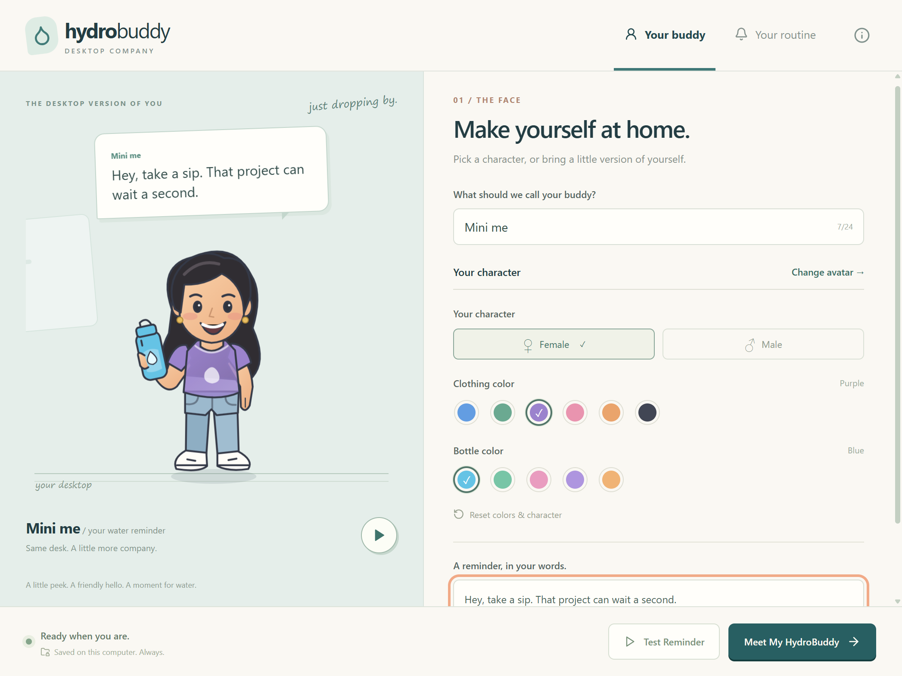

# HydroBuddy 1.7 💧

A small, friendly desktop hydration companion. HydroBuddy lives in your system tray, walks onto your desktop for a gentle water reminder, reacts to your answer, and waves goodbye. Windows first; no browser extension, server, account, analytics, AI service, or internet connection at runtime.



## Run locally

Use Node.js **22.19+** and npm on Windows 10/11 (64-bit).

```sh
npm install
npm run dev
```

First launch opens a simple avatar chooser. Pick a character or drop a PNG/WebP onto the popup. **Use my own image** also offers a file picker and **Try the supplied avatar**, which loads the included transparent character with one click. Your choice opens the main editor. Built-in clothing and bottle colors can be changed; imported artwork keeps its original colors. Name your buddy, write a greeting, and press the circular **Preview walk** button to try the motion. **Meet My HydroBuddy** saves your choices, hides settings, and gives you an immediate first visit. Future visits default to **60 minutes after the previous visit finishes**. Open settings again from the droplet in the Windows system tray (it may be in the hidden-icons overflow).

## Your own avatar and the new walk

**Use my own image** opens a local file picker. PNG and WebP are supported, up to 8 MB, 4096 pixels per side and 12 megapixels. Choose a full-body character with a transparent background. The application copies it into its own preferences folder, so moving the original file does not break it. Images are validated, reduced to at most 768 pixels on the longest side, and trimmed only around transparent padding. Opaque backgrounds are kept and flagged in the interface. No image generation, upload, account, or network access is involved.

Every visit now uses one sequence: a half-visible lean around the right edge, a walk into view, your greeting, a question, a reaction, and a wave goodbye. There is no animation-style selector or side-image slot. Existing profile preferences migrate to this sequence.

The supplied character uses eight individually authored complete-body walking poses, including bent-knee passing steps and changes in torso and arm position. Each pose lasts 135 ms; arrival takes 3 seconds and departure 3.2 seconds. The approved peek, real sad face for **Not yet**, wave and happy pose are retained. She faces left while entering from the right, faces you for the reminder, and faces right while leaving. Built-in characters have animated arms and legs. Other uploaded single images use a steady whole-image entrance and cannot invent leg motion or new facial expressions automatically.

To test with the supplied avatar already selected on your own computer:

```sh
npm run dev:personal
```

This explicit development mode saves the supplied character into your normal local profile and opens the editor, preserving your reminder settings. Regular `npm run dev` then keeps that selection.

Saved imports and personal text survive restart. Replacing/removing an already-saved asset deletes that old managed copy after saving; the original source image is untouched. Unsaved draft imports can remain in the local avatars folder. If a managed image is manually deleted, the companion falls back to a built-in figure and Settings asks you to import it again. Existing V1 preferences migrate automatically.

For a temporary **10-second** timer:

```sh
npm run dev:fast
```

Fast mode is session-only and is ignored in installed/packaged builds. Your saved 30/45/60/90-minute preference is preserved. **Test Reminder** runs a complete visit immediately, even when reminders are paused. It saves your current settings first.

## Build and package

```sh
npm run build
npm run package
```

The Windows x64 NSIS installer is written to **`release/HydroBuddy-Setup.exe`**. It supports per-user installation, an installation directory picker, a desktop shortcut, and standard Windows uninstall. The unpacked application is `release/win-unpacked/HydroBuddy.exe`. You can also run `npm run package:dir` to build only the unpacked application. Packaging initially downloads Electron and packaging tools; the installed application works offline.

Builds are unsigned. Windows SmartScreen may show a warning. Before public distribution, obtain a code-signing certificate, replace `build.win.signExecutable: false` with your signing configuration, and test installation and removal on a clean Windows machine. Preferences intentionally survive uninstall so reinstalling restores the buddy; remove `%APPDATA%/HydroBuddy` to erase them (development may use `%APPDATA%/hydrobuddy`).

Auto-start is **off by default**. The installed application can enable it explicitly under **Your routine → Be here when I log in**. It starts hidden in the tray. The toggle is disabled in development to avoid registering the development Electron executable.

## Features

- Female and male layered SVG avatars, six clothing colors, five bottle colors, immediate live preview.
- Shared walking, breathing, waving, celebration, and gentle sad animations with adjustable expressions.
- Transparent, frameless, compact desktop window; above normal windows and never automatically takes keyboard focus.
- Empty transparent areas pass mouse input through to the underlying app; speech bubble controls accept clicks.
- Greeting, Yes / Not yet responses with locally selected messages, a dismiss button, and a 45-second unanswered timeout.
- A single reminder schedule in Electron's main process; no duplicate visits from repeated test clicks.
- System tray settings, test, pause/resume, and quit. Closing settings keeps HydroBuddy running.
- Local validated JSON preferences written via a temporary file and rename; corrupt files are backed up before falling back to defaults.
- OS reduced-motion preference, screen work-area positioning, display-change handling, and a fresh interval after sleep.
- Personal studio with editable name/greeting, local avatar imports, drag-and-drop chooser, and a peek-and-walk preview.
- Original vector avatars and icons. The supplied transparent character illustration is retained at `src/renderer/public/welcome-buddy.png` and can be selected with **Try the supplied avatar**.

## Verification

```sh
npm run typecheck
npm run lint
npm test
npm run test:desktop
```

After packaging, `node scripts/packaged-smoke.cjs` checks the real executable with isolated preferences, verifies onboarding and the overlay, and confirms that production ignores fast mode and schedules an hour. The local validation results are recorded in [docs/VALIDATION.md](docs/VALIDATION.md).

Unit tests cover persistence, input validation, timer lifecycle, pause, duplicate prevention, watchdog recovery, resume, and animation phase transitions. The desktop integration script launches real Electron windows using Playwright, exercises onboarding/customization, restarts with persisted preferences, tests both responses, dismiss/reduced motion, pause/test, and the real fast timer with settings hidden. It writes screenshots to `test-results/` and uses an isolated `.test-data/` profile. Run it in an interactive Windows session. It does not modify your regular preferences or OS auto-start setting.

Manual release checks: verify the tray menu and overflow icon, click through transparent areas over VS Code/Word, keep typing as a reminder enters, change primary display/scaling, suspend/resume, install/uninstall, and opt in/out of auto-start in the installed app. Exclusive fullscreen applications and secure desktop screens are outside V1's overlay scope.

## Structure

```text
src/
  main/
    main.ts                 App lifetime, narrow IPC handlers, startup integration
    windows.ts              Secure windows and display placement
    reminderManager.ts      Main-process reminder scheduling
    storage.ts              Validated, atomic local preferences
    avatarAssets.ts         Local image validation, normalization and managed copies
    tray.ts                 System tray menu
  preload/index.ts          Only the typed HydroBuddy API
  shared/
    api.ts                  Renderer/main contract
    preferences.ts          Defaults, palettes and validation
  renderer/
    screens/Settings.tsx    Onboarding, live preview, reminders and About
    screens/Companion.tsx   Reminder interaction state machine
    components/             Avatar chooser, shared figure, whole-body walking, reactions and preview
    hooks/                  Cached local avatar loading
    animations/reminder.ts  Timing, transitions and local messages
    public/                 Supplied transparent illustration
    avatar.css              Shared body-part animation system
    styles.css              Application and companion styles
resources/                  App and tray icons
scripts/                    Icon generation and desktop integration verification
tests/                      Timer, persistence and interaction unit tests
```

Appearance (`AvatarAppearance`), animation (`AnimationState`/`Expression`), and reminder timing are separate. `BuddyFigure` selects the built-in drawing or imported artwork; both use the same reminder phase sequence. AI generation is not included.

## Security and privacy

`contextIsolation`, renderer sandboxing and web security are enabled; `nodeIntegration` is disabled. The preload exports only specific actions. Main-process handlers check sender window and top-level frame; settings payloads are validated and reconstructed from allowed fields. Navigation, new windows, and permission requests are denied. A content security policy restricts renderer resources. There are no remote fonts, analytics, tracking, or production network requests in application code.

## Known limitations

- Primary display only. The OS taskbar work area is respected; tiny displays, unusual scaling, and exclusive fullscreen apps need further device testing.
- The companion deliberately cannot take keyboard focus. Its controls are pointer-operated; settings are keyboard accessible. An optional focused/keyboard-accessible companion mode is a useful next accessibility improvement.
- Sleep does not accumulate missed visits. Resume begins a fresh full interval. Quitting and restarting also starts a fresh interval.
- Pausing during a visit hides it immediately. Dismissing normally plays the exit animation.
- macOS has platform-aware startup support and a packaging target, but its tray behavior, transparency, signing and notarization have not been tested. Build and validate macOS on a Mac before release.
- No sound, hydration analytics, AI generation, cloud features, or medical recommendations.
- Arbitrary uploaded flat artwork cannot articulate limbs or change its drawn expression automatically. The supplied character includes a bundled pose atlas; built-in figures use joint animation. Other images have a steady, non-hopping entrance.
- The build toolchain currently includes moderate upstream audit findings in electron-builder's downloader dependency tree. Production dependencies pass `npm audit --omit=dev`; recheck and update the toolchain before public distribution.

Electron window behavior follows the [Electron BrowserWindow documentation](https://www.electronjs.org/docs/latest/api/browser-window). Installer configuration follows the [electron-builder NSIS documentation](https://www.electron.build/docs/nsis/).

## Suggested next steps

Test the installer on a clean Windows account, add a signed release pipeline and Windows CI, test multiple DPI/display combinations, then validate macOS. Consider a keyboard-accessible companion mode before broad release.

The supplied reaction atlas is `src/renderer/public/buddy-motion-atlas.png`, and the walking frames are `src/renderer/public/walk-v2/step-01.png` through `step-08.png`. Its built-in image-generation prompts are recorded in [docs/AVATAR-ART.md](docs/AVATAR-ART.md). No generation service is used by the installed app. `node scripts/motion-check.cjs` verifies the unchanged edge reveal, all eight full-body frames, direction and response expressions.

The latest complete-body frame prompts are in [docs/WALK-FRAMES-V2.md](docs/WALK-FRAMES-V2.md). Reminder buttons use native cursor hit-testing over the speech bubble, including when it appears beneath a stationary pointer.
